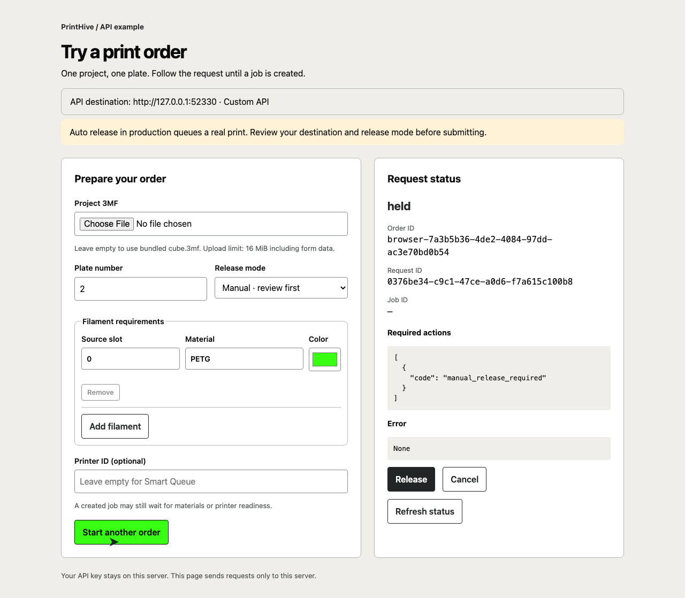

# Create a Print Hive job from your backend

This React, TypeScript, Vite and shadcn/ui sample accepts a commerce order, sends a project 3MF to PrintHive, and follows creation through live job status. A Node backend keeps the SDK and API credential on the server. It uses the published `@printhive/api@0.2.0` package from npm. A job represents one plate. An order with several plates sends one request per plate.

The CLI and HTTP backend share the same durable order store. Your API key stays on the server. Job creation does not mean a printer has started or finished. Hive retains its readiness, bed-clear, material, and queue checks.

## Current API limit

The [original local proof notes](proof/README.md) record a processing race found during early verification. They are historical evidence, not a statement about the current production deployment. Source inspection can still hold a request for review; partner-supplied plate data does not approve those findings.

## Set up

1. Install Node.js 20 or later.
2. Create a Print Hive account and an organization. Add a qualified printer to your organization before submitting work.
3. Create an organization API key with **Control** scope. Control includes read access and also permits raw G-code, stopping printers, and temperature changes across the organization. Protect this key accordingly. Never choose **Dangerous** for this sample.
4. Install the dependencies:

   ```sh
   npm ci
   npm ls @printhive/api
   ```

   Expect `@printhive/api@0.2.0`. The lockfile resolves the npm registry tarball, with no workspace links.

5. Set `PRINTHIVE_API_KEY` privately in your shell or server environment. Do not commit it or put it in browser code. Optionally set `PRINTHIVE_BASE_URL` to your own development API. The default is the SDK's public API. HTTP is accepted only for loopback development.

The included `fixtures/cube.3mf` is a synthetic, single-plate PETG project for a P1S with a 0.4 mm nozzle. It is adapted from a synthetic fixture and a Bambu Studio round-trip used to retain stable object identities. It contains a small mesh and slicing settings, with no customer model or printer credentials. Treat it as an integration fixture, not a qualified production part.

## Send an order from the CLI

Inspect `fixtures/order.json`, then run:

```sh
npm run send-print -- fixtures/order.json
```

The first output is the accepted creation receipt with a `requestId`. Polling ends with a receipt such as:

```json
{
  "requestId": "…",
  "status": "created",
  "job": { "id": 123, "printer_id": null }
}
```

The actual receipt contains additional fields. A null printer means Smart Queue owns later assignment. To pin the job, add `printer_id` with a printer UUID to the order. The target must belong to your organization.

To order several plates, set `plates` to their one-based numbers, such as `[1, 2]`, and use a project that contains those plates. Filament `sourceSlot` values are zero-based. Each entry supplies `material` and a `#RRGGBB` color. This small example applies the same filament requirements to every requested plate. Split an order into separate order IDs when plates need different mappings.

Run the same command after a network failure or restart. The store retains one key per plate before the first outbound call. It also keeps a private copy of the source bytes. Submitted plates retain their request IDs. A retry of an incomplete submission uses the stored key. Changed bytes, plate selection, release policy, filename, or printer under the same order ID fail locally. Use a new order ID for changed intent.

`data/` contains the store and source copies. Keep this directory across restarts. Run exactly one backend process per store directory. For a production deployment, replace it with a transactional database with unique order/plate keys and serialized writes. Add retention and backups for the source files.

## Develop the React app

Use Node 20.19 or later. Set `PRINTHIVE_API_KEY` privately for the Node backend, then run:

```sh
npm run dev
```

Vite serves the React app at <http://127.0.0.1:5173> with hot reload. The Node API listens on port 3078. Vite proxies the existing local API routes, so the browser never receives the SDK credential. `API_PORT` changes the development backend port.

The frontend lives in `client/`; `components.json` configures the official shadcn registry. UI primitives are generated from its Radix Nova style. The app uses PrintHive semantic theme tokens and locally bundled fonts. The browser imports only the two shared pure mapping/status helpers from the backend source tree. Development file access is restricted to frontend assets, dependencies and those helpers; saved orders, uploaded files and Node-only source cannot be downloaded through Vite.

## Build and run the full app

```sh
npm run build
npm start
```

The Node server serves the compiled React app and its API on the same loopback port, 3000 by default. Set `PORT=3077` to use the local testing address. Keep `ORDER_DATA_DIR` unchanged across restarts to retain order identities and source snapshots. A missing frontend build returns an explicit setup error.

```sh
npm start
curl --fail-with-body http://127.0.0.1:3000/orders \
  -H 'Content-Type: application/json' \
  -d '{"id":"http-order-1001","file":"cube.3mf","plates":[1],"filaments":[{"sourceSlot":0,"material":"PETG","color":"#39FF14"}]}'
curl --fail-with-body http://127.0.0.1:3000/orders/http-order-1001
```

`POST /orders` returns HTTP 202 with the order ID and the creation request IDs. `GET /orders/{id}` returns the current receipt for each plate, including required actions and API errors. Source filenames resolve under `DESIGN_DIR`, which defaults to `fixtures`. Provision trusted project files there on the server. The CLI instead accepts a server filesystem path in its order JSON.

The server binds to loopback and has no customer authentication. Before exposing it, add your own authentication, order authorization, request limits, and a trusted design catalog. Do not accept arbitrary filesystem paths from customers. `PORT`, `ORDER_DATA_DIR`, and `DESIGN_DIR` configure the local sample.

## Try an order in your browser

With `PRINTHIVE_API_KEY` set privately on the server, run `npm run build` and `npm start` and open <http://127.0.0.1:3000/>. The banner shows the destination from `PRINTHIVE_BASE_URL`, which defaults to `https://api.printhiv3d.com`.

**Auto release in production queues a real print.** The form defaults to manual release so you can review the held request before authorizing it.

1. Choose a `.3mf` file, or leave the upload empty to use `fixtures/cube.3mf`.
2. Set the one-based plate number. Add filament requirements with zero-based source slots, material names, and colors.
3. Optionally enter a printer ID. Leave it empty for Smart Queue assignment.
4. Select the release mode and click **Submit order**.
5. Follow the request ID and live status. For a manual hold, review **Required actions**, then click **Release**. Click **Cancel** to stop a request before job creation.

The page polls the create request once per second until `created`, `failed`, or `cancelled`. A held request keeps polling. After creation, it reads the live job until a terminal job state or an unavailable job ends that follow-up. A created receipt shows its job ID when the job still exists. Network errors leave the outcome unknown, and polling retries. If submission fails, **Retry same order** keeps the original ID and input to avoid a duplicate. Reload to change that input. **Start another order** clears the page without cancelling the previous order.

Uploads use multipart `POST /orders` with an `order` JSON field and a `file` field. The server limits the entire request to 16 MiB, copies the source into the durable order store, and removes its temporary upload directory. JSON requests keep the existing 64 KiB limit. The browser uses only this server's routes and never receives the API key. `GET /config` returns the destination without URL credentials, query strings, or fragments.

Historical pre-React UI evidence: 

The [original UI proof](proof/ui/README.md) is historical and uses a loopback stub. The running example uses the configured real API. Tests use local fixtures and do not submit production orders.

## Authorize or cancel a manual request

Set `release` to `"manual"` in a new order. The request prepares the plate and then reaches `held` with `requiredActions`. The CLI prints that receipt and exits with code 2.

```sh
npm run send-print -- release REQUEST_ID
npm run send-print -- status ORDER_ID
npm run send-print -- cancel ANOTHER_REQUEST_ID
```

The backend exposes `POST /orders/{id}/{plate}/release` and `POST /orders/{id}/{plate}/cancel` for the same operations. These call HTTP directly because SDK 0.2.0 has no release or cancel helper. They require Control scope. Read the status after a lost control response before deciding whether to repeat the action. The wrapper does not automatically retry control calls.

Release authorizes only a manual hold. It cannot approve an unrelated preparation hold. Cancel works before job creation. Once a job exists, use Hive's job cancellation workflow instead.

## Handle stopped or unsettled work

`waitForJob` calls `printJobs.waitUntilCreated` and catches `PrintJobCreateStoppedError`. It returns the stopped receipt without authorizing work.

- `held`: present `requiredActions` for operator review. For unresolved preparation holds, cancel and submit corrected input with a new order ID.
- `failed`: inspect `error`, correct the input or configuration, and submit a new order.
- `cancelled`: stop processing this request.
- `created`: save the job ID. A retained receipt can have `job: null` if the job was deleted.

A timeout or network error leaves the outcome unknown. Query the stored request ID or retry the unchanged order. The CLI exits with code 1 for these failures. The SDK retries eligible transient failures with the same key. An idempotency conflict means the same key reached Hive with different intent or bytes. Do not resolve it by silently generating a new key.

A filament mismatch ordinarily creates a job with filament waiting reasons rather than a pre-job `held` receipt. A created job may still wait for materials or readiness.

## Verify

```sh
npm test
```

The tests also cover multipart uploads, request size limits, malformed input, static assets, and sanitized configuration. The original tests cover plate mapping, persisted keys before submission, concurrent retries, restart recovery after a lost response, changed-intent rejection, manual requests, stopped receipts, and polling failure handling.

`proof/run.mjs` drives this application against an already provisioned, owned local Hive API with mock printers. Set `PRINTHIVE_BASE_URL`, `PRINTHIVE_API_KEY`, and `MOCK_PRINTER_ID` privately, then run `npm run proof`. It rejects remote APIs. Provisioning the Hive stack and slicing engine is outside this public sample. Never point the proof runner at real printers. The proof transcript in `proof/local-e2e.log` records only selected response fields and no credentials.

The print-order flow uses public print-job create, create-request polling, job reads, release, and cancel routes. It does not depend on partner source or preparation endpoints.

## Follow a named-printer job through filament waiting

See the [SDK adoption audit](docs/sdk-upgrade.md) and [isolated end-to-end test plan](docs/e2e-plan.md) for the release requirements, confirmed waiting-reason contract and mock-printer acceptance cases.

Choose a 3MF, select one plate, confirm its source filaments and select their Hive material requirements. Enter the isolated mock printer's UUID under **Printer ID**. The sample sends the file and that selected plate through `hive.printJobs.create` to `POST /v1/print-jobs/create`, with typed `filaments`, `printer_id`, `release` and `on_filament_mismatch` fields.

**Wait** is the default mismatch policy. Once slicing and output processing allow admission, Hive can create a job that waits for filament. **Reject** sends `on_filament_mismatch: "reject"`; a mismatch refuses admission with HTTP 422. With manual release, first review and release the request before evaluating the final admission result. Preparation holds remain distinct from filament waiting on an existing job.

The sample first polls `hive.printJobs.getCreateRequest`. A `created` receipt identifies the resulting job, whose current state is then read through `hive.printJobs.get`, calling `GET /v1/print-jobs/{id}`. The UI keeps the create-request status separate from job status and continues polling the job while it is active. Creation is not proof that materials match or the printer is ready. A deleted job retains its original receipt; a temporary job-read failure says status is unknown and does not submit a new job.

The job panel renders API-reported `filament_waiting_reasons` with material, color swatches, Source Slot and any supplied `suggestedTargetSlot`. Source Slots are project indices. They are never converted into printer tray indices or assigned by a filtered reason's position. A physical location is shown only when the API supplies it, labeled as API AMS/slot indices. Otherwise the UI explicitly says placement remains unresolved.

For a named mock printer, expand **Optional placement on a named printer** on a source filament and enter both API AMS ID and API slot ID. These optional indices become that filament's `targetSlot` in the preview, durable intent and request. They do not come from its Source Slot. Leave both fields empty for Hive to resolve placement; clearing the printer removes hints from the outgoing request. API AMS IDs 254 and 255 accept only slot 0. Changing a pinned hint requires a new order ID.

The confirmed response lists only unmet filaments at job creation and claim recheck. Each row can include `cause`: `slot_empty`, `missing_material`, `color_distance` or `slot_conflict`. The job panel explains recognized causes and keeps an absent or unknown cause readable. Response colors may be six hex digits with or without `#`; displayed swatches normalize them while the raw API JSON stays unchanged. SDK 0.3.2 on main includes `FilamentWaitingReason` and live job reads, but is not yet published. Local preview builds may use the workspace client; public setup will pin the registry release after the real-stack proof and Node 20/24 registry-install tests pass. Request fields and mismatch policy are unchanged.

`on_filament_mismatch` belongs to immutable order intent. Replaying a saved order retains its policy, source bytes, catalog selections and idempotency key. Changing the policy under the same order ID conflicts. Historical orders without a stored policy retain their original omitted field, whose API default is wait.

The npm dependency remains 0.2.0 until the approved 0.3.2 release is published and verified. Install a locally packed SDK build containing `printJobs.get` for complete job following. The configuration response reports that method's availability. An older SDK shows an explicit unavailable message instead of silently adding another HTTP client.

All automated job writes and claim checks must use the owned isolated API, real database and Cloud Slice with mock printers. The live sample's configured production API is not a writable test fixture. Production may return `plate_selection_host_update_required` until its Host supports plate selection; the sample displays that admission result rather than bypassing it.

## License

MIT. See [LICENSE](LICENSE).

## Map plate filaments to Hive requirements

Printie normally processes its own project files. This example bridges that step: selecting a 3MF uploads it to the local example backend, which extracts its actual Bambu plate numbers and filament palette. This operation creates no Hive request or print job and never executes embedded G-code.

1. Choose a project 3MF. The plate selector shows **Reading project…** while extraction runs. Changing the file clears the previous plate data and requirement selections.
2. Choose one of the extracted plates. The example reads plate identities from `Metadata/model_settings.config`, rather than guessing plate 1.
3. Under **Source filaments used on this plate**, review the candidates and click **Use these source filaments**. When valid saved slice metadata identifies source slots, the UI initially filters to those entries and prechecks them. The label says **From saved slice metadata; confirm usage** because saved data can be stale or overinclusive. Use **Show all project filaments** to adjust the set. Extra entries you selected stay visible when the filter is restored. With missing, malformed, conflicting, out-of-range, or unsupported mixed-filament metadata, the UI shows the full palette with no entries assumed used. Confirm each plate separately. This small extractor does not decode painted triangles or prove a plate’s complete current usage.
4. For every confirmed source filament, search the real Hive catalog by name, brand, SKU, or exact Hive filament UUID. Explicitly choose a result. Use **More results** for the next page. Catalog presence does not establish printer compatibility or loaded inventory.
5. Click **Preview API request** to resolve the selections and inspect the payload without creating a job. Submit only when you want to create an actual request.

The bundled cube has known plate data and does not need an upload. Uploaded projects retain their original zero-based source filament indices. Switching plates preserves separate source confirmations and catalog selections. Changing a confirmation clears that plate’s previous requirements. Loading another file clears all of them. The browser rejects stale extraction responses after a file change.

### Local extraction limits

`POST /project-data/inspect` accepts one multipart `.3mf` file under the example’s 16 MiB total HTTP request limit. It uses pinned `yauzl` and `saxes` packages, reads `Metadata/project_settings.config`, `Metadata/model_settings.config`, optional `Metadata/plate_N.json` files, and optional `Metadata/slice_info.config`. It never expands mesh geometry. Extraction rejects malformed ZIPs, unsafe or duplicate paths, encrypted entries, symbolic links, more than 1,000 archive entries, metadata documents exceeding 4 MiB of actual inflated bytes or 16 MiB across all read metadata, invalid JSON, XML DTDs/entities, and XML exceeding 64 levels or 64,000 elements. Missing plate metadata produces an explicit error, not an invented plate option. Unknown or incomplete palette entries remain unselectable.

The backend returns the exact uploaded-file SHA-256. The confirmed project data stays bound to that filename and hash; order submission verifies the bytes again. Only the selected plate’s confirmed source filaments enter the mapped order intent. Extracting metadata and confirming source usage do not approve or remove Hive’s own inspection holds.

Saved plate JSON uses zero-based `filament_ids`; saved slice XML uses one-based `<filament id>` values and one-based plate indices. The extractor joins these by the actual plate number and preserves source identities rather than matching by color. Duplicate colors remain distinct source slots. Available cached type/color fields are checked against the current palette. Two conflicting saved datasets cause an unresolved fallback. Object extruder assignments and `filament_maps` are not treated as complete plate usage.

Displayed colors have bordered swatches beside their readable hex values: source palette candidates, confirmed source filaments, catalog results and selected Hive requirements. JSON request previews and the optional data editor keep their literal copyable JSON and show an adjacent color legend.

### Optional known Printie data

If Printie already has authoritative per-plate data, open **Advanced: supply known Printie plate data** and paste or import JSON instead of confirming the extracted palette:

```json
{
  "plates": [
    {
      "number": 2,
      "filaments": [
        {
          "sourceSlot": 0,
          "name": "Body",
          "material": "PETG",
          "color": "#000000"
        },
        {
          "sourceSlot": 3,
          "name": "Accent",
          "material": "PETG",
          "color": "#FFFFFF"
        }
      ]
    }
  ]
}
```

Click **Use project data** to bind that manifest to the current file. Importing JSON is optional; it is not required to populate the plate selector after uploading a project.

### What the Hive API receives

The public job API currently accepts `filaments: [{ sourceSlot, material, color, targetSlot? }]`. It does **not** accept material/filament IDs or SKUs in those rows. Selecting a catalog product resolves its material type and hex color into the supported fields. The server resolves the ID before first submission and keeps the catalog ID, name, and SKU in its durable order record. Replays retain that original snapshot even if the catalog changes or becomes unavailable. Hive matches type and color; it does not require that exact product or SKU. A `PETG-CF` type stays `PETG-CF`, and missing or ambiguous colors cannot silently become a guessed color.

The example sends no `targetSlot`. When no printer is specified, Smart Queue determines the physical material routing later. Explicit printer selection retains the same requirement payload and still undergoes Hive’s qualification and readiness checks.

SDK 0.2.0 has no catalog methods. The backend therefore uses a thin authenticated read-only adapter for `GET /v1/materials` and `GET /v1/materials/:id`. The browser talks only to the local `/catalog` proxy, which returns selected public catalog fields and never the API key. Search text is limited to 100 characters and paginated in pages of 20. The preview endpoint performs catalog reads only. Existing CLI callers can continue supplying typed filament requirements directly.

The HTTP mapped-order form adds `projectData` and `mappings: [{ sourceSlot, materialId }]` alongside its existing single selected plate. The backend verifies complete mappings, binds the source filename and hash, resolves the selected catalog entries, then calls the SDK with only the supported fields. Original source metadata and chosen catalog records remain part of immutable order intent, so a changed mapping conflicts with the same order ID.

Source knowledge does not bypass inspection. An API hold such as `custom_instructions` or `material_usage_unresolved` remains a hold until Hive supports or completes the required review.

### Saved usage format references

The index conversions follow Bambu Studio's format at revision 79df7ae309be398ed30c9f397c13c9911c2edc57:

- [Plate JSON export](https://github.com/bambulab/BambuStudio/blob/79df7ae309be398ed30c9f397c13c9911c2edc57/src/libslic3r/Format/bbs_3mf.cpp#L7168) and [ID/color population](https://github.com/bambulab/BambuStudio/blob/79df7ae309be398ed30c9f397c13c9911c2edc57/src/slic3r/GUI/Plater.cpp#L23975).
- [Saved plate index](https://github.com/bambulab/BambuStudio/blob/79df7ae309be398ed30c9f397c13c9911c2edc57/src/libslic3r/Format/bbs_3mf.cpp#L8782) and [one-based filament IDs](https://github.com/bambulab/BambuStudio/blob/79df7ae309be398ed30c9f397c13c9911c2edc57/src/libslic3r/Format/bbs_3mf.cpp#L8901).

These records describe saved slicing results. They can be absent, stale, or overinclusive, so the demo labels them as hints and still requires confirmation. It does not substitute object extruder assignments for a complete painting, support, or feature-level material analysis.

## Sync Printie’s filament catalog

The **Sync Printie filament catalog** panel is separate from print orders. It writes organization-owned catalog records through `hive.filamentCatalog.upsert`; read-back uses the same SDK’s `list` and `get` methods. The existing requirement search still reads the broader global and organization catalog.

### Use a local SDK before publication

The registry dependency remains `@printhive/api@0.2.0` until the approved npm release is available. The waiting-reason branch declares unpublished 0.3.1 and exports `FilamentWaitingReason`. Development verification uses a built local integration workspace containing that contract plus the live-job read method. The live-job read method must also reach main before a released package can provide the complete example flow.

Build the SDK with its normal build and drift checks, then link its workspace:

```sh
npm run sdk:local -- /absolute/path/to/built/packages/api-client
```

The same helper still accepts a packed `.tgz` file. It installs without saving a dependency or changing the lockfile. Workspace installation skips lifecycle scripts because the workspace must already be built. It verifies catalog methods without HTTP and records local provenance under ignored `data/sdk-local.json`; a workspace entry hash is not a hash of the complete bundle. The page shows the actual loaded version, workspace/package provenance and method availability. Workspace provenance is checked against the loaded package path, so a stale marker cannot mislabel a later registry install as a workspace.

Restart the example after installing. A clean `npm ci` restores the declared registry package. Older SDKs disable unavailable catalog/job-read controls; validation preview and existing creation remain available. No REST catalog-sync fallback is added. Publication remains gated on the waiting-reason PR merging; the final sample dependency will use the published npm version rather than this development link.

### Preview and sync catalog records

Paste or import a JSON array, or an object containing only `records`:

```json
[
  {
    "externalId": "printie-filament-123",
    "brand": "Example",
    "material": "PETG",
    "colorName": "Green",
    "colorHex": "#39FF14",
    "sku": "PETG-GREEN",
    "replacementFilamentId": null
  }
]
```

`externalId` is Printie’s stable filament identity. It is distinct from a project’s source slot and from the Hive catalog UUID returned after sync. This is the example’s explicit catalog-record schema, not a claim about every field in Printie’s HAR payload.

1. Import or paste 1–20 records. Importing changes only the local editor.
2. Click **Validate and preview**. Every record is checked before any write, including required fields, lengths, hex colors, unsupported fields, and duplicate trimmed external IDs. No catalog write occurs during preview.
3. Review canonical external IDs, SKUs, material types, and color swatches. `hex` is accepted as an alias for `colorHex`; if both exist they must agree. Colors normalize to uppercase. Brand/material/color names are bounded to 100 characters, external IDs/SKUs to 200, and the whole request to 64 KiB.
4. Click **Sync this record** or the explicit batch **Sync … to production** button. This is a real catalog write to the displayed API destination. Batch records run sequentially. The UI reports each confirmed record and each uncertain/error outcome, preserving partial results.
5. Use **Refresh synced catalog** or **Read filament** to read current Hive bindings by external ID, SKU, or Hive UUID. Reads are organization-scoped by the API. Retrying an external ID targets its stable catalog identity; the UI does not invent created/updated flags. For an uncertain result, read current state before retrying.

`replacementFilamentId` is optional informational metadata, at most 200 characters or null. It does not authorize a substitute, change an existing order, or automatically replace another SKU.

Catalog upsert requires the API key’s Control permission; list/read require Read permission. Credentials remain on the backend. The browser receives only the fields needed to show the Printie-to-Hive binding. Errors omit raw upstream bodies, SQL, headers and credentials.

Local routes:

- `POST /catalog-sync/preview`: validates the entire import; no SDK calls.
- `POST /catalog-sync/upsert`: validates the entire batch before sequential SDK upserts; returns per-record confirmed/error outcomes.
- `GET /catalog-sync/list?externalId=…&sku=…&limit=20&offset=0`: reads synced organization catalog entries through the SDK.
- `GET /catalog-sync/filaments/{id}`: reads one synced binding through the SDK.

After sync, copy the product’s SKU or Hive UUID into the existing source-filament requirement chooser. The example does not guess which source slot gets that product. Print orders send only the supported `{ sourceSlot, material, color, targetSlot? }` fields. `targetSlot` is omitted unless the user explicitly supplies a placement hint for a named printer. Exact product/SKU enforcement is separate API work; syncing a catalog identity does not add that guarantee to a job.

Automated verification uses injected SDK fixtures and read-only production catalog checks. It must not click Sync or submit orders against production merely to verify the UI.

See [catalog sync verification](proof/catalog-sync/README.md) for the real SDK contract checks, production read results, desktop and phone demos, and remaining proof limits.

A denied live job read stops automatic job polling. The existing create-receipt error path still retries on denied access; revoke/reload behavior there remains a follow-up.

See [job-flow verification](docs/job-flow-verification.md) for local test results, labeled UI demos and the remaining real-stack and release work.

## Verify the migration

```sh
npm run build
npm test
npm run test:ui
```

Backend tests cover real local HTTP serving, upload limits, preserved order intent, SDK adapters and private-file protection. React tests exercise requirement selection, request previews and immutable retries. The browser demo uses the built React app, actual SDK and Node backend against an explicitly labeled owned HTTP fixture; it covers uploaded plate selection, four filament mappings, manual release, live waiting reasons, rejection and catalog sync. These checks do not establish real Cloud Slice slicing, printer claims or physical printing. The separate real-stack release proof must pass before publishing the SDK and sample.

The shipped app has no mock API mode. Its destination and SDK source are shown in the page. Credentials stay in the Node process; never put them in a `VITE_` environment variable. Use `npm run sdk:local` only for an explicitly local SDK build until the approved npm release is available.
